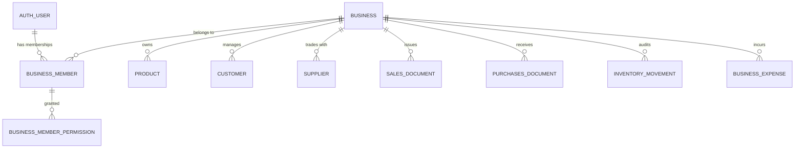
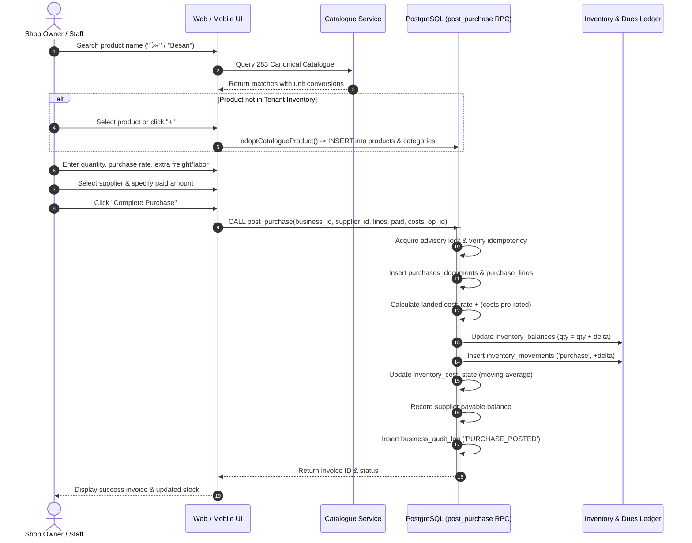

# Mini ERP (হিসাব) — Developer Handoff Documentation

> **Complete Technical Guide & Architectural Reference for External Engineering Teams**  
> **Release Candidate:** `0.1.0-RC1` | **Status:** `RELEASE_CANDIDATE_READY_FOR_OWNER_UAT`

---

## Table of Contents

1. [Executive Overview](#1-executive-overview)
2. [Business Model & Multi-Tenancy](#2-business-model--multi-tenancy)
3. [Complete Module Documentation](#3-complete-module-documentation)
   - 3.1. [Home & Dashboard](#31-home--dashboard)
   - 3.2. [Authentication & Account Management](#32-authentication--account-management)
   - 3.3. [Business & Shop Management](#33-business--shop-management)
   - 3.4. [Product Master Data](#34-product-master-data)
   - 3.5. [Catalogue Search & Tenant Adoption](#35-catalogue-search--tenant-adoption)
   - 3.6. [Product Categories](#36-product-categories)
   - 3.7. [Product Units & Conversions](#37-product-units--conversions)
   - 3.8. [Supplier Management](#38-supplier-management)
   - 3.9. [Purchase Engine](#39-purchase-engine)
   - 3.10. [Inventory & Stock Ledger](#310-inventory--stock-ledger)
   - 3.11. [Sales Engine](#311-sales-engine)
   - 3.12. [Registered Customer Management](#312-registered-customer-management)
   - 3.13. [Walk-in Customers & Mobile Snapshots](#313-walk-in-customers--mobile-snapshots)
   - 3.14. [Invoices & Transaction History](#314-invoices--transaction-history)
   - 3.15. [Expense Management](#315-expense-management)
   - 3.16. [Profit Estimator (Sandboxed Scenario Calculator)](#316-profit-estimator-sandboxed-scenario-calculator)
   - 3.17. [Cost of Goods Sold (COGS) Engine](#317-cost-of-goods-sold-cogs-engine)
   - 3.18. [Profit & Loss Reporting](#318-profit--loss-reporting)
   - 3.19. [Staff Permissions & Access Control](#319-staff-permissions--access-control)
   - 3.20. [Activity Audit Trail](#320-activity-audit-trail)
   - 3.21. [Settings & Language Management](#321-settings--language-management)
4. [End-to-End Business Workflows](#4-end-to-end-business-workflows)
5. [Important Business Rules & Invariants](#5-important-business-rules--invariants)
6. [Product Catalogue Architecture](#6-product-catalogue-architecture)
7. [Database Architecture & Schema Reference](#7-database-architecture--schema-reference)
8. [Authorization, RLS & Security Architecture](#8-authorization-rls--security-architecture)
9. [Source Code Navigation & File Responsibilities](#9-source-code-navigation--file-responsibilities)
10. [UI & Design Conventions](#10-ui--design-conventions)

---

## 1. Executive Overview

**Mini ERP (হিসাব)** is a production-grade, multi-tenant commercial trading ERP designed for small and medium enterprises (wholesalers, distributors, retail traders) in Bangladesh.

### Core Objectives

1. **Bengali-First Usability:** The interface uses culturally grounded Bengali terminology (হিসাব, বাকি, জমা, খরচ, লাভ, চালান) and local calendar formatting (Dhaka timezone, Bengali/Latin numerals), allowing non-technical store clerks and owners to manage operations with minimal onboarding.
2. **Transactional Integrity:** All stock mutations, invoice numbers, accounts receivable (dues), accounts payable, and cash movements are recorded atomically inside PostgreSQL functions (`post_sale`, `post_purchase`, `record_expense`). The client never performs multi-step REST operations that could leave the database in an inconsistent state.
3. **Strict Isolation:** Multi-tenancy is enforced at the database layer via PostgreSQL Row Level Security (RLS). A user authenticated to one business tenant cannot inspect, query, or mutate records of another tenant.
4. **Canonical Catalogue:** A curated 283-product central grocery/trading catalogue enables instant search in Bengali, English, or Banglish without manual item entry. Products are adopted into the tenant's inventory upon first purchase.

---

## 2. Business Model & Multi-Tenancy



### 2.1. Tenant Structure

- **Business (`public.businesses`):** The primary multi-tenant container. All transactional tables contain a foreign key `business_id UUID REFERENCES public.businesses(id)`.
- **User Roles (`public.business_members`):**
  - `OWNER`: Complete authority over the business, its settings, staff invitations, and all financial ledgers. Has implicit bypass for all granular permissions (`can(tenant, action)` always returns `true`).
  - `STAFF`: Restricted collaborator role. Staff members operate under a strict **default-deny** model and can only perform actions explicitly granted in `public.business_member_permissions`.
- **Platform Developer:** A platform-level maintenance concept. Platform developers have no automatic merchant-level financial or ledger access.

### 2.2. Trading Partners: Customers vs. Shops

- **Retail Customers:** Individuals who buy goods. May be walk-in cash customers (no account created) or registered credit customers.
- **Customer Shops (`customer_type = 'SHOP'`):** Trading partners who purchase wholesale. Shops have unique business-scoped shop codes (e.g., `SH001`), owner names, shop stall numbers, and credit terms. A customer shop is a trading partner record, **not** a tenant identity or login account.
- **Suppliers:** Vendors from whom inventory is procured. Supplier dues are tracked distinctly from customer receivables.

---

## 3. Complete Module Documentation

### 3.1. Home & Dashboard

- **Purpose:** Provide an at-a-glance overview of daily business health and quick shortcuts to frequent actions.
- **Responsibilities:** Display daily sales volume, daily purchase cost, total receivables (customer due), total payables (supplier due), today's operating expenses, and low-stock indicators.
- **User Actions:** Navigate to primary workflows (New Sale, New Purchase, Add Shop, Stock Ledger, Expenses, Estimator).
- **Related Entities:** `sales_documents`, `purchases_documents`, `customer_due_summary`, `supplier_due_summary`, `business_expenses`, `inventory_balances`.
- **Permissions:** `sales.view`, `purchases.view`, `reports.view`, `invoices.read`.
- **Source Files:** [`apps/web/src/MasterDataWorkspace.tsx`](../apps/web/src/MasterDataWorkspace.tsx), [`apps/web/src/OperationsPanels.tsx`](../apps/web/src/OperationsPanels.tsx).
- **Test Coverage:** Covered by Playwright suite [`e2e/01-auth-and-nav.spec.ts`](../e2e/01-auth-and-nav.spec.ts).

### 3.2. Authentication & Account Management

- **Purpose:** Secure merchant identity, authentication, and multi-tenant session binding.
- **Responsibilities:** Email/password login, password recovery via email, session refresh via PKCE tokens, initial business registration onboarding.
- **User Actions:** Sign up, sign in, request password reset, enter recovery token, update password, sign out.
- **Validation Rules:** Email format; password minimum 8 characters; phone numbers formatted to 11-digit Bangladeshi mobile format (`01XXXXXXXXX`).
- **Related Entities:** `auth.users`, `public.profiles`, `public.businesses`, `public.business_members`.
- **Permissions:** Public/Authenticated.
- **Source Files:** [`packages/shared/src/auth.ts`](../packages/shared/src/auth.ts), [`apps/web/src/FoundationApp.tsx`](../apps/web/src/FoundationApp.tsx).
- **Test Coverage:** Unit tests [`packages/shared/tests/auth.test.ts`](../packages/shared/tests/auth.test.ts), pgTAP suite [`supabase/tests/database/identity_tenancy.test.sql`](../supabase/tests/database/identity_tenancy.test.sql), Playwright [`e2e/01-auth-and-nav.spec.ts`](../e2e/01-auth-and-nav.spec.ts).

### 3.3. Business & Shop Management

- **Purpose:** Maintain merchant store profile and partner retail/wholesale shop directory.
- **Responsibilities:** Create, view, search, edit, and soft-archive customer shops.
- **User Actions:** Add new shop, search by shop name or unique shop code, inspect transaction history for a specific shop, edit contact information, archive shop.
- **Required Data:** Shop Name, Owner Name, Unique Shop Code, Mobile Number (`01XXXXXXXXX`). Optional: Shop Number, Email, Address, Linked Supplier.
- **Validation Rules:** Shop code must be unique per business; mobile number must match valid BD mobile regex.
- **Related Entities:** `public.customers` (`customer_type = 'SHOP'`).
- **Permissions:** `customers.view`, `customers.manage`.
- **Source Files:** [`apps/web/src/OperationsPanels.tsx`](../apps/web/src/OperationsPanels.tsx) (lines 1500–2170), [`packages/shared/src/master-data-service.ts`](../packages/shared/src/master-data-service.ts).
- **Test Coverage:** Playwright suite [`e2e/02-shops-and-catalogue.spec.ts`](../e2e/02-shops-and-catalogue.spec.ts).

### 3.4. Product Master Data

- **Purpose:** Maintain tenant-specific product master catalog.
- **Responsibilities:** Product registration, SKU assignment, base unit assignment, default selling price, minimum stock thresholds, preferred supplier links, and soft-archiving.
- **User Actions:** Create custom product, edit pricing, search items, filter by category, soft-archive product.
- **Validation Rules:** Bengali name required; selling price $\ge 0$; unit reference required; category reference must belong to the same tenant.
- **Related Entities:** `public.products`, `public.product_categories`, `public.product_units`.
- **Permissions:** `products.view`, `products.manage`.
- **Source Files:** [`apps/web/src/MasterDataWorkspace.tsx`](../apps/web/src/MasterDataWorkspace.tsx), [`packages/shared/src/master-data-service.ts`](../packages/shared/src/master-data-service.ts).
- **Test Coverage:** Unit tests [`packages/shared/tests/master-data.test.ts`](../packages/shared/tests/master-data.test.ts), pgTAP [`supabase/tests/database/master_data.test.sql`](../supabase/tests/database/master_data.test.sql).

### 3.5. Catalogue Search & Tenant Adoption

- **Purpose:** Enable fast search across 283 pre-populated Bangladeshi commercial commodities and dynamically adopt them into tenant inventory.
- **Responsibilities:** Trilingual fuzzy normalization (Bengali script, English translation, Banglish phonetic text); checking whether an item already exists in tenant inventory; automatically creating the tenant product record and corresponding tenant category on adoption.
- **User Actions:** Type keyword in Purchase/Sales search bar (e.g., "Chira", "হলুদ", "Soyabean"); select catalogue card; auto-adopt item into tenant inventory.
- **Related Entities:** `public.central_catalogue`, `public.products`, `public.product_categories`.
- **Permissions:** `products.manage`, `purchases.create`.
- **Source Files:** [`packages/shared/src/catalogue.ts`](../packages/shared/src/catalogue.ts), [`packages/shared/src/catalogue-service.ts`](../packages/shared/src/catalogue-service.ts).
- **Test Coverage:** Unit tests [`packages/shared/tests/catalogue-283.test.ts`](../packages/shared/tests/catalogue-283.test.ts), [`packages/shared/tests/catalogue-adoption.test.ts`](../packages/shared/tests/catalogue-adoption.test.ts).

### 3.6. Product Categories

- **Purpose:** Categorize inventory for reporting and filtering.
- **Responsibilities:** Tenant-scoped category creation, editing, and soft-archiving.
- **Related Entities:** `public.product_categories`.
- **Permissions:** `categories.view`, `categories.manage`.
- **Source Files:** [`packages/shared/src/master-data-service.ts`](../packages/shared/src/master-data-service.ts).

### 3.7. Product Units & Conversions

- **Purpose:** Handle wholesale-to-retail package conversions.
- **Responsibilities:** Convert composite packaging (বস্তা, কার্টন, ডজন, জোড়া, খাঁচা, ড্রাম, বান্ডিল) to base metric quantities (কেজি, লিটার, পিস) using catalogue-defined conversion factors.
- **Validation Rules:** Quantities must convert cleanly; fractionable vs. non-fractionable unit enforcement.
- **Related Entities:** `public.product_units`.
- **Source Files:** [`packages/shared/src/units.ts`](../packages/shared/src/units.ts).
- **Test Coverage:** Unit tests [`packages/shared/tests/units.test.ts`](../packages/shared/tests/units.test.ts).

### 3.8. Supplier Management

- **Purpose:** Maintain records of wholesale distributors and vendors.
- **Responsibilities:** Supplier profile CRUD, contact tracking, accounts payable (due) calculation.
- **Related Entities:** `public.suppliers`, `public.supplier_due_summary`.
- **Permissions:** `suppliers.view`, `suppliers.manage`.
- **Source Files:** [`packages/shared/src/master-data-service.ts`](../packages/shared/src/master-data-service.ts).

### 3.9. Purchase Engine

- **Purpose:** Procure inventory, calculate landed costs, record supplier debt, and increase warehouse stock.
- **Responsibilities:** Multi-item purchase cart, landed cost calculation (pro-rating freight/labor charges across items), supplier selection, payment recording (Cash, bKash, Nagad, Bank), and atomic posting via `public.post_purchase` RPC.
- **User Actions:** Search catalogue/products, add to cart, specify purchase price and quantity, enter transportation/labor costs, enter paid amount, post purchase.
- **Validation Rules:** Quantities $> 0$, unit prices $> 0$, paid amount $\ge 0$ and $\le$ total bill. Supplier required.
- **Related Entities:** `public.purchases_documents`, `public.purchase_lines`, `public.inventory_movements`, `public.inventory_balances`, `public.inventory_cost_state`.
- **Permissions:** `purchases.create`, `purchases.view`.
- **Source Files:** [`apps/web/src/OperationsPanels.tsx`](../apps/web/src/OperationsPanels.tsx) (lines 2877–3400).
- **Test Coverage:** Playwright [`e2e/03-purchase-and-sales.spec.ts`](../e2e/03-purchase-and-sales.spec.ts), pgTAP [`supabase/tests/database/accounting_operations.test.sql`](../supabase/tests/database/accounting_operations.test.sql).

### 3.10. Inventory & Stock Ledger

- **Purpose:** Real-time visibility into warehouse balances and immutable movement history.
- **Responsibilities:** Display current stock quantities, low-stock threshold alerts, zero-stock highlighting (`.ops-zero-stock-row`) with red `স্টক শেষ` badge, and full chronological movement ledger (`opening`, `purchase`, `sale`, `adjustment`).
- **Validation Rules:** Negative stock strictly prohibited by default constraint (`CHECK (quantity >= 0)`).
- **Related Entities:** `public.inventory_balances`, `public.inventory_movements`.
- **Permissions:** `inventory.view`, `inventory.adjust`.
- **Source Files:** [`apps/web/src/OperationsPanels.tsx`](../apps/web/src/OperationsPanels.tsx) (lines 4350–4750), [`packages/shared/src/inventory-service.ts`](../packages/shared/src/inventory-service.ts).
- **Test Coverage:** Playwright [`e2e/04-stock-and-history.spec.ts`](../e2e/04-stock-and-history.spec.ts), pgTAP [`supabase/tests/database/inventory_ledger.test.sql`](../supabase/tests/database/inventory_ledger.test.sql).

### 3.11. Sales Engine

- **Purpose:** Point-of-Sale (POS) counter billing and wholesale dispatch.
- **Responsibilities:** Fast multi-product cart, stock sufficiency pre-check, customer selection (registered customer vs. walk-in cash customer), payment method selection, atomic document generation, and balance reduction via `public.post_sale` RPC.
- **User Actions:** Add product to cart, adjust selling price (requires `sales.price_override` or owner role), enter paid amount, confirm sale.
- **Validation Rules:** Sale quantity cannot exceed current available stock; paid amount must equal total for walk-in customers (credit requires a registered customer record).
- **Related Entities:** `public.sales_documents`, `public.sales_lines`, `public.inventory_movements`, `public.inventory_balances`, `public.customer_due_summary`.
- **Permissions:** `sales.create`, `sales.view`, `sales.price_override`.
- **Source Files:** [`apps/web/src/OperationsPanels.tsx`](../apps/web/src/OperationsPanels.tsx) (lines 2200–2876), [`packages/shared/src/sales-service.ts`](../packages/shared/src/sales-service.ts).
- **Test Coverage:** Unit tests [`packages/shared/tests/sales.test.ts`](../packages/shared/tests/sales.test.ts), Playwright [`e2e/03-purchase-and-sales.spec.ts`](../e2e/03-purchase-and-sales.spec.ts).

### 3.12. Registered Customer Management

- **Purpose:** Manage customer accounts with credit terms and ledger balances.
- **Responsibilities:** Customer profile CRUD, transaction ledger history, automated receivable tracking via `customer_due_summary`.
- **Related Entities:** `public.customers`, `public.customer_due_summary`.
- **Permissions:** `customers.view`, `customers.manage`, `payments.receive`.
- **Source Files:** [`packages/shared/src/master-data-service.ts`](../packages/shared/src/master-data-service.ts).

### 3.13. Walk-in Customers & Mobile Snapshots

- **Purpose:** Support spontaneous cash retail sales while preserving contact traceability without profile pollution.
- **Responsibilities:** When `customer_id` is null, an optional phone number can be captured. The system stores it directly in `sales_documents.customer_phone_snapshot` as an immutable record on the invoice.
- **Privacy Rule:** Under privacy migration `20261108000300_remove_phone_from_sale_audit.sql`, personal mobile numbers are excluded from the public audit log metadata.
- **Validation Rules:** Mobile must be valid BD format if provided, but may be left blank.
- **Related Entities:** `public.sales_documents`.
- **Test Coverage:** Unit tests [`packages/shared/tests/phone.test.ts`](../packages/shared/tests/phone.test.ts), pgTAP [`supabase/tests/database/sales_phone_persistence.test.sql`](../supabase/tests/database/sales_phone_persistence.test.sql).

### 3.14. Invoices & Transaction History

- **Purpose:** Search and inspect historical commercial documents.
- **Responsibilities:** Unified chronological list of Sales (`S-YYYYMMDD-XXXXXXXX`) and Purchase (`P-YYYYMMDD-XXXXXXXX`) invoices. Full-text search by invoice ID, partner name, customer phone snapshot, or date range.
- **User Actions:** Filter by date, search invoice, view line-item details, print invoice.
- **Related Entities:** `public.sales_documents`, `public.sales_lines`, `public.purchases_documents`, `public.purchase_lines`.
- **Permissions:** `invoices.read`, `sales.view`, `purchases.view`.
- **Source Files:** [`apps/web/src/OperationsPanels.tsx`](../apps/web/src/OperationsPanels.tsx) (lines 5800–6400).
- **Test Coverage:** Playwright [`e2e/04-stock-and-history.spec.ts`](../e2e/04-stock-and-history.spec.ts).

### 3.15. Expense Management

- **Purpose:** Track non-inventory operating overhead.
- **Responsibilities:** Record operating expenses across standard categories: `Transportation` (পরিবহন), `Rent` (দোকান ভাড়া), `Electricity` (বিদ্যুৎ), `Salary` (বেতন), and `Other` (অন্যান্য). Custom notes explain 'Other' expenses and appear in the ledger. Safe voiding via `public.void_expense` RPC.
- **Validation Rules:** Amount $> 0$; category required; date required.
- **Related Entities:** `public.business_expenses`.
- **Permissions:** `expenses.create`, `expenses.view`, `expenses.void`.
- **Source Files:** [`apps/web/src/OperationsPanels.tsx`](../apps/web/src/OperationsPanels.tsx) (lines 5140–5450).
- **Test Coverage:** Playwright [`e2e/05-expenses-and-settings.spec.ts`](../e2e/05-expenses-and-settings.spec.ts).

### 3.16. Profit Estimator (Sandboxed Scenario Calculator)

- **Purpose:** Allow traders to simulate margins before committing capital.
- **Responsibilities:** Sandboxed calculation: inputs for purchase quantity, purchase price, expected selling price, estimated transport cost, other expenses, and anticipated product waste/damage percentage.
- **Isolation Guarantee:** Completely decoupled from database ledgers. Changing values in the estimator never mutates live stock or financial balances.
- **Source Files:** [`apps/web/src/OperationsPanels.tsx`](../apps/web/src/OperationsPanels.tsx) (lines 5460–5790).

### 3.17. Cost of Goods Sold (COGS) Engine

- **Purpose:** Accurate inventory valuation and margin accounting.
- **Mechanism:** Weighted moving average cost tracking managed in `public.inventory_cost_state`.
- **Unpriced Opening Stock Isolation:** When inventory exists from unpriced opening records (`unpriced_quantity > 0`), the system marks the sale's COGS as `UNKNOWN` rather than falsely asserting 100% margin. Verified by migration `20261108000400_fix_unpriced_stock_cogs_evaluation.sql`.

### 3.18. Profit & Loss Reporting

- **Purpose:** Management accounting and financial performance analysis.
- **Calculations:**
  - **Net Sales Revenue:** Sum of sales document totals within period.
  - **Cost of Goods Sold (COGS):** Total recognized cost for goods sold where cost is known.
  - **Gross Profit:** Net Sales Revenue $-$ COGS.
  - **Operating Expenses:** Sum of active (non-voided) business expenses within period.
  - **Net Operating Profit:** Gross Profit $-$ Operating Expenses.
- **Permissions:** `reports.view`.
- **Source Files:** [`apps/web/src/OperationsPanels.tsx`](../apps/web/src/OperationsPanels.tsx) (lines 6410–6820).

### 3.19. Staff Permissions & Access Control

- **Purpose:** Protect business data and delegate operational duties securely.
- **Model:** Default-deny staff matrix. Owners can assign specific operational capabilities to staff users: `sales.create`, `sales.view`, `sales.price_override`, `purchases.create`, `purchases.view`, `inventory.view`, `inventory.adjust`, `expenses.create`, `expenses.view`, `expenses.void`, `customers.manage`, `suppliers.manage`, `reports.view`, `settings.manage`.
- **Related Entities:** `public.business_members`, `public.business_member_permissions`.
- **Source Files:** [`packages/shared/src/permissions.ts`](../packages/shared/src/permissions.ts).
- **Test Coverage:** Unit tests [`packages/shared/tests/auth.test.ts`](../packages/shared/tests/auth.test.ts), Playwright [`e2e/05-expenses-and-settings.spec.ts`](../e2e/05-expenses-and-settings.spec.ts).

### 3.20. Activity Audit Trail

- **Purpose:** Accountability and operational forensic logging.
- **Responsibilities:** Server-enforced logging of business events: `SALE_POSTED`, `PURCHASE_POSTED`, `EXPENSE_RECORDED`, `EXPENSE_VOIDED`, `MEMBER_INVITED`, `PERMISSION_CHANGED`.
- **Related Entities:** `public.business_audit_log`.
- **Source Files:** [`apps/web/src/OperationsPanels.tsx`](../apps/web/src/OperationsPanels.tsx) (lines 7070–7200).

### 3.21. Settings & Language Management

- **Purpose:** Customization of user language and business identity.
- **Responsibilities:** Toggle preferred language between Bengali (`bn`) and English (`en`). Updates user's `profiles.preferred_language` in real time. Business name and contact configuration.
- **Related Entities:** `public.profiles`, `public.business_settings`.
- **Source Files:** [`apps/web/src/OperationsPanels.tsx`](../apps/web/src/OperationsPanels.tsx) (lines 6825–7065).
- **Test Coverage:** Playwright [`e2e/05-expenses-and-settings.spec.ts`](../e2e/05-expenses-and-settings.spec.ts).

---

## 4. End-to-End Business Workflows

### 4.1. The Purchase-to-Stock Workflow



### 4.2. The Point-of-Sale (POS) Sales Workflow

```mermaid
sequenceDiagram
    autonumber
    actor Cashier as Sales Staff / Owner
    participant Web as Web / Mobile UI
    participant DB as PostgreSQL (post_sale RPC)
    participant Ledg as Inventory & Customer Dues

    Cashier->>Web: Select products from stock catalogue
    Cashier->>Web: Choose customer type (Registered Shop OR Cash Walk-in)
    alt Walk-in Cash Sale
        Cashier->>Web: Leave customer blank; optionally enter customer mobile
        Cashier->>Web: Enter full payment (paid == total)
    else Registered Shop Credit Sale
        Cashier->>Web: Select registered shop from dropdown
        Cashier->>Web: Enter partial payment (paid < total)
    end
    Cashier->>Web: Click "Complete Sale"
    Web->>DB: CALL post_sale(business_id, customer_id, lines, paid, method, op_id, phone)
    activate DB
    DB->>DB: Acquire advisory lock & check idempotency
    DB->>DB: Lock inventory_balances (FOR UPDATE)
    DB->>DB: Enforce stock check: IF requested > balance THEN raise error
    DB->>DB: Insert sales_documents & sales_lines
    DB->>Ledg: Deduct inventory_balances (qty = qty - delta)
    DB->>Ledg: Insert inventory_movements ('sale', -delta)
    DB->>DB: Evaluate COGS (KNOWN if priced; UNKNOWN if unpriced stock)
    alt Credit Sale
        DB->>Ledg: Update customer outstanding balance (total - paid)
    end
    DB->>DB: Insert business_audit_log ('SALE_POSTED' without customer phone)
    DB-->>Web: Return invoice ID & status
    deactivate DB
    Web-->>Cashier: Print/Display invoice (S-YYYYMMDD-XXXXXXXX)
```

---

## 5. Important Business Rules & Invariants

1. **Stock Entry Exclusivity:** Inventory is normally introduced through the **Purchase Workflow** (`post_purchase`) or opening balance adjustments. There is no manual balance overwrite field that bypasses the ledger.
2. **Negative Stock Prevention:** Sales that exceed available inventory are blocked at both client and database levels. Database check constraint `CHECK (quantity >= 0)` guarantees no phantom negative inventory.
3. **Idempotency Guarantee:** All document-generating RPCs accept an `operation_id UUID`. Re-submitting the same operation ID returns the existing document without re-incrementing/decrementing inventory or balances.
4. **Tenant Isolation Invariant:** Every query, read, and write is scoped by `business_id`. Cross-tenant data leaks are structurally prevented by Row Level Security.
5. **No Mixed-Unit Mathematics:** Floating point numbers are strictly forbidden for financial calculations. PostgreSQL `NUMERIC(14,2)` handles currency; quantities use exact conversion factors.
6. **Phone Snapshot Distinction:** Walk-in cash customer phone numbers are recorded as immutable snapshots on `sales_documents` only. They do not generate registered `customers` rows, preventing master directory clutter.
7. **COGS Truthfulness:** Profit reporting isolates items with unpriced opening stock. If cost cannot be proven, COGS is reported as `UNKNOWN` rather than reporting false margin.

---

## 6. Product Catalogue Architecture

The central catalogue contains **283 canonical consumer commodities** frequently traded across Bangladesh (grocery, spices, personal care, dry foods, cleaning supplies).

- **Data File Reference:** [`packages/shared/src/catalogue.ts`](../packages/shared/src/catalogue.ts).
- **Search Normalization:**
  - Bengali script (e.g., `আলু`, `দারুচিনি`, `মিনিকেট চাল`).
  - English translation (e.g., `Potato`, `Cinnamon`, `Miniket Rice`).
  - Banglish phonetic variants (e.g., `Aloo`, `Darchini`, `Chira`).
- **Catalogue Adoption Workflow:**
  When a merchant searches for a catalogue item that is not yet in their store, the frontend invokes `adoptCatalogueProduct()`. This safely:
  1. Creates or resolves a matching category in `public.product_categories` for that tenant.
  2. Resolves the unit reference in `public.product_units`.
  3. Inserts a new row in `public.products` with `name_bn`, `name_en`, `name_banglish`, `sku`, and default selling price.
- **Image-Free Catalogue Policy:**
  Per explicit user instruction, the operational catalogue is completely image-free to optimize counter performance, eliminate CDN dependencies, and respect bandwidth limitations in rural commercial hubs.

---

## 7. Database Architecture & Schema Reference

### 7.1. Database Tables Overview

| Table Name                    | Responsibility                            | Primary Key | Key Foreign Keys                         |
| :---------------------------- | :---------------------------------------- | :---------- | :--------------------------------------- |
| `profiles`                    | User profiles & language preference       | `id`        | `id REFERENCES auth.users`               |
| `businesses`                  | Multi-tenant merchant business accounts   | `id`        | `created_by REFERENCES auth.users`       |
| `business_members`            | Tenant membership & merchant roles        | `id`        | `business_id`, `user_id`                 |
| `business_member_permissions` | Staff granular permission assignments     | Composite   | `business_id`, `user_id`                 |
| `products`                    | Tenant inventory product catalog          | `id`        | `business_id`, `category_id`, `unit_id`  |
| `central_catalogue`           | Global 283-item canonical catalogue       | `id`        | None (Platform-wide)                     |
| `product_categories`          | Tenant product classifications            | `id`        | `business_id`                            |
| `product_units`               | Measurement units (base & composite)      | `id`        | `business_id`                            |
| `customers`                   | Registered buyers & customer shops        | `id`        | `business_id`, `linked_supplier_id`      |
| `suppliers`                   | Procurement vendors                       | `id`        | `business_id`                            |
| `purchases_documents`         | Procurement invoice headers               | `id`        | `business_id`, `supplier_id`             |
| `purchase_lines`              | Procurement invoice line items            | `id`        | `purchases_document_id`, `product_id`    |
| `sales_documents`             | Sales invoice headers & phone snapshots   | `id`        | `business_id`, `customer_id`             |
| `sales_lines`                 | Sales invoice line items & COGS status    | `id`        | `sales_document_id`, `product_id`        |
| `inventory_balances`          | Current aggregated stock quantities       | Composite   | `business_id`, `product_id`              |
| `inventory_movements`         | Immutable stock mutation audit ledger     | `id`        | `business_id`, `product_id`, `source_id` |
| `inventory_cost_state`        | Weighted moving-average cost state        | Composite   | `business_id`, `product_id`              |
| `business_expenses`           | Operating expense records                 | `id`        | `business_id`                            |
| `business_audit_log`          | Server-side security & activity audit log | `id`        | `business_id`, `actor_id`                |

### 7.2. Important Views & RPC Functions

- **`customer_due_summary` (View):** Aggregates unpaid sales document amounts grouped by customer:
  $$\text{Outstanding} = \sum (\text{total\_amount} - \text{paid\_amount\_at\_sale} - \text{allocated\_receipts})$$
- **`supplier_due_summary` (View):** Aggregates unpaid purchase document amounts grouped by supplier.
- **`public.post_purchase(...)` (RPC):** Atomic execution of purchase header, lines, landed cost calculation, inventory increment, and accounts payable update.
- **`public.post_sale(...)` (RPC):** Atomic execution of sales header, lines, stock decrement with concurrency lock, COGS evaluation, and receivables update.
- **`public.record_expense(...)` (RPC):** Atomic entry of operating expenses.
- **`public.void_expense(...)` (RPC):** Safe reversal of misrecorded expenses with reason audit.
- **`public.register_initial_business(...)` (RPC):** Atomically onboards a new merchant, creating business profile, membership as `OWNER`, and default settings.

---

## 8. Authorization, RLS & Security Architecture

1. **Authentication Boundary:** Managed exclusively by Supabase Auth (`auth.users`). Passwords and tokens never touch the custom application backend.
2. **Tenant Resolution:** The active tenant is determined by the signed-in user's active membership in `public.business_members`. Clients cannot forge tenant membership.
3. **PostgreSQL RLS Functions:**
   - `private.current_business_id()`: Retrieves active business context.
   - `private.has_business_permission(b_id, perm)`: Checks if the calling user is an `OWNER` of the tenant or has been granted the specific permission in `business_member_permissions`.
4. **Least-Privilege API Access:**
   - Direct `INSERT`, `UPDATE`, or `DELETE` on financial documents (`sales_documents`, `purchases_documents`, `inventory_movements`) is revoked from the `authenticated` role. Mutations MUST execute via security definer RPC functions.
5. **Customer Privacy Protection:** Customer mobile numbers captured on walk-in retail sales are stored exclusively on the invoice document and are stripped from server-wide audit logs.

---

## 9. Source Code Navigation & File Responsibilities

| Path                                                                                      | Purpose & Primary Contents                                                           |
| :---------------------------------------------------------------------------------------- | :----------------------------------------------------------------------------------- |
| [`apps/web/src/FoundationApp.tsx`](../apps/web/src/FoundationApp.tsx)                     | Auth state gate, tenant onboarding router, session lifecycle management              |
| [`apps/web/src/MasterDataWorkspace.tsx`](../apps/web/src/MasterDataWorkspace.tsx)         | Dashboard, Master Data management (Products, Categories, Units, Partners)            |
| [`apps/web/src/OperationsPanels.tsx`](../apps/web/src/OperationsPanels.tsx)               | Primary operations: Sales POS, Purchases, Stock Ledger, Expenses, Invoices, Settings |
| [`apps/web/src/InventoryWorkspace.tsx`](../apps/web/src/InventoryWorkspace.tsx)           | Standalone inventory workspace view                                                  |
| [`apps/web/src/SalesWorkspace.tsx`](../apps/web/src/SalesWorkspace.tsx)                   | Dedicated sales counter workspace view                                               |
| [`packages/shared/src/auth.ts`](../packages/shared/src/auth.ts)                           | Universal authentication and multi-tenant session state machine                      |
| [`packages/shared/src/permissions.ts`](../packages/shared/src/permissions.ts)             | Merchant permission definitions & staff access evaluation                            |
| [`packages/shared/src/catalogue.ts`](../packages/shared/src/catalogue.ts)                 | 283 Canonical trilingual product catalogue dataset                                   |
| [`packages/shared/src/catalogue-service.ts`](../packages/shared/src/catalogue-service.ts) | Trilingual catalogue search and tenant adoption service                              |
| [`packages/shared/src/units.ts`](../packages/shared/src/units.ts)                         | Product unit conversions and package mathematics                                     |
| [`packages/shared/src/sales-service.ts`](../packages/shared/src/sales-service.ts)         | Sales payload validation and conversion service                                      |
| [`packages/shared/src/phone.ts`](../packages/shared/src/phone.ts)                         | Bangladeshi mobile number normalization and regex validation                         |
| [`supabase/migrations/`](../supabase/migrations/)                                         | 14 Canonical database schema migrations                                              |
| [`supabase/tests/database/`](../supabase/tests/database/)                                 | 6 pgTAP database assertion suites                                                    |
| [`e2e/`](../e2e/)                                                                         | 6 Playwright browser integration test suites (58 tests)                              |

---

## 10. UI & Design Conventions

The design system strictly adheres to the approved **Version 3 হিসাব** visual standard:

- **Color Palette:**
  - Primary Green / Accent: `#135b43` (Bangladeshi deep evergreen)
  - Surface Ink: `#213b32`
  - Mint Background Surface: `#e8f3ec`
  - Neutral Background: `#f5f7f8`
  - Danger / Zero-Stock Red: `#c62828`
  - Soft Red Highlight: `.ops-zero-stock-row`
- **Typography:**
  - Bengali script: `Hind Siliguri` (Google Font, bundled locally)
  - English numerals & Latin characters: `Manrope` (Google Font, bundled locally)
  - Minimum touch targets: 44px for primary mobile interaction buttons.
- **Responsiveness:** Full responsive flexbox/grid layout functioning seamlessly across 360px mobile viewports up to 4K desktop displays.
