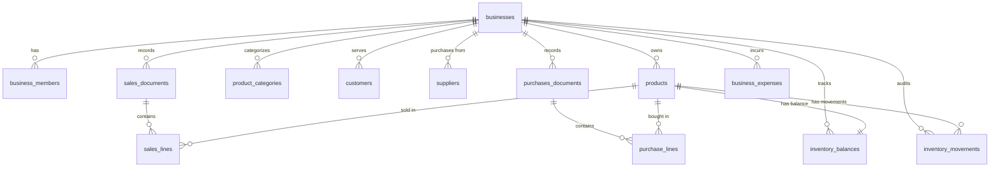
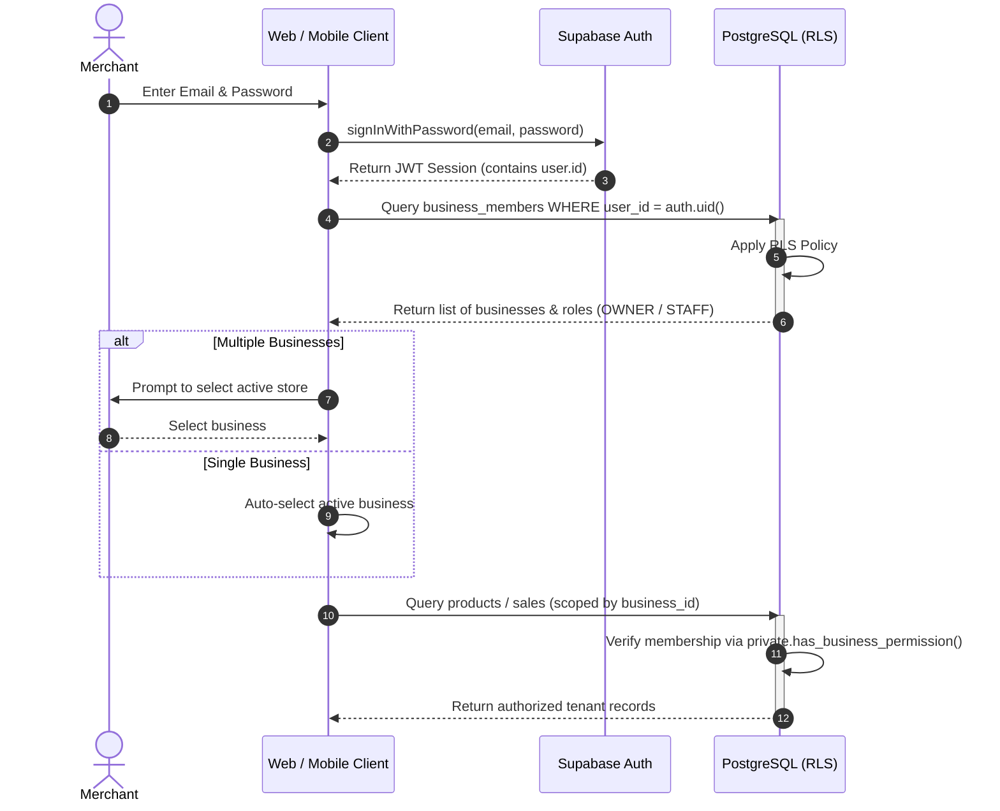
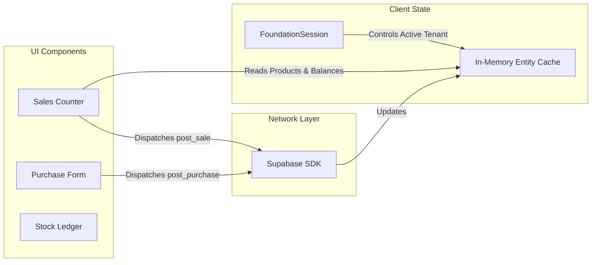

# Mini ERP (হিসাব) — Technical Architecture Reference

> **Comprehensive Engineering & System Architecture Specification**  
> **Release Candidate:** `0.1.0-RC1` | **Authoritative Baseline:** Phase 2A–8.3 Implementation

---

## 1. System Overview

Mini ERP is architected as an offline-resilient, backend-as-a-service (BaaS) single-database system. It eliminates redundant intermediate application servers (e.g., traditional Express/NestJS layers) in favor of database-enforced security, transactional PostgreSQL functions, and direct client queries mediated by Row Level Security (RLS).

```mermaid
graph TB
    subgraph Client Layer
        Web["Web Client (React 19 + Vite SPA)<br/>apps/web"]
        Mobile["Mobile Client (React Native + Expo)<br/>apps/mobile"]
    end

    subgraph Shared Domain Layer
        Shared["Universal Logic & Typed Contracts<br/>packages/shared"]
    end

    subgraph Supabase Platform Layer
        Auth["Supabase Auth (JWT / PKCE)"]
        PostgREST["Supabase Data API (PostgREST)"]
        RPC["PostgreSQL Transactional RPCs"]
    end

    subgraph Database Layer (PostgreSQL 15+)
        RLS["Row Level Security Policies"]
        Tables["Relational Tables (Multi-Tenant)"]
        Views["Materialized & Dynamic Views"]
        Audit["Immutable Audit & Movement Ledgers"]
    end

    Web --> Shared
    Mobile --> Shared
    Web -- HTTPS / WSS --> PostgREST
    Web -- HTTPS --> RPC
    Web -- HTTPS --> Auth
    Mobile -- HTTPS --> PostgREST
    Mobile -- HTTPS --> RPC
    Mobile -- HTTPS --> Auth

    PostgREST --> RLS
    RPC --> Tables
    RLS --> Tables
    Tables --> Views
    Tables --> Audit
```

---

## 2. Monorepo & Workspace Architecture

The codebase is organized using native **npm workspaces** (`node >= 22.13.0`):

```
.
├── apps/
│   ├── web/                    # Browser application (@mini-erp/web)
│   └── mobile/                 # Android mobile application (@mini-erp/mobile)
├── packages/
│   └── shared/                 # Universal library (@mini-erp/shared)
├── supabase/                   # Database migrations, config, and test suites
└── e2e/                        # End-to-end Playwright tests
```

### Dependency Graph & Workspace Rules

- `apps/web` depends on `packages/shared`.
- `apps/mobile` depends on `packages/shared`.
- `packages/shared` depends only on `@supabase/supabase-js`.
- Cross-import between `apps/web` and `apps/mobile` is strictly prohibited.
- All domain logic, translations, unit conversion mathematics, catalogue data, and database types reside in `packages/shared` to guarantee 100% parity between web and mobile experiences.

---

## 3. Frontend Application Structure (`apps/web`)

The web frontend is a React 19 Single Page Application bundled with Vite.

### Routing & View Architecture

Rather than relying on heavy third-party routing libraries that introduce bundle bloat and routing lag, navigation is coordinated through an authenticated session state router:

1. **`src/main.tsx`:** Mounts root element and initializes Hind Siliguri and Manrope fonts.
2. **`src/FoundationApp.tsx`:** Primary lifecycle container:
   - Evaluates authentication status via `FoundationSession`.
   - Renders Auth Gate (Login, Signup, Password Reset) when unauthenticated.
   - Handles tenant onboarding if the user has no business memberships.
   - Provides tenant switching context if the user belongs to multiple stores.
   - Manages top-level application view states (`MasterDataWorkspace`, `OperationsPanels`, `SalesWorkspace`, `InventoryWorkspace`, or `DemoMode`).
3. **`src/OperationsPanels.tsx`:** Comprehensive operational shell housing:
   - Sales Counter (`SalesPanel`)
   - Purchase Processing (`PurchasesPanel`)
   - Stock Ledger (`InventoryPanel`)
   - Customer Shop Directory (`ShopsPanel`)
   - Operating Expenses (`ExpensesPanel`)
   - Invoice History (`InvoicesPanel`)
   - Profit Estimator (`EstimatorPanel`)
   - Reports & Analytics (`ReportsPanel`)
   - Staff Access Control & Permissions (`StaffPanel`)
   - Store Settings (`SettingsPanel`)

---

## 4. Mobile Application Structure (`apps/mobile`)

The mobile client is an Android-first React Native application powered by Expo:

- **Runtime:** React Native 0.88 with the high-performance Hermes bytecode engine.
- **Entry Point:** `apps/mobile/index.ts` $\to$ `apps/mobile/App.tsx`.
- **Session Persistence:** Uses `@react-native-async-storage/async-storage` for secure offline JWT token storage.
- **Parity with Web:** Shares the exact same `FoundationSession` state machine from `packages/shared/src/auth.ts`.
- **Packaging:** Produces standalone APKs and Google Play Android App Bundles (`.aab`) via Expo CLI and EAS Build.

---

## 5. Shared Package Responsibilities (`packages/shared`)

The shared workspace encapsulates all business invariants:

| Module                 | Primary File               | Responsibilities                                                                            |
| :--------------------- | :------------------------- | :------------------------------------------------------------------------------------------ |
| **Authentication**     | `src/auth.ts`              | Multi-tenant session state machine, profile fetching, tenant switching, permission checking |
| **Permissions**        | `src/permissions.ts`       | Role definitions (`OWNER`, `STAFF`), staff permission tokens, capability guards             |
| **Product Catalogue**  | `src/catalogue.ts`         | 283 Canonical products, trilingual metadata, search indices                                 |
| **Catalogue Service**  | `src/catalogue-service.ts` | Trilingual search algorithms, fuzzy matching, tenant product adoption logic                 |
| **Unit Engine**        | `src/units.ts`             | Base units (কেজি, লিটার, পিস), composite packaging conversions, decimal math                |
| **Sales Calculations** | `src/sales-service.ts`     | Line item total computations, stock sufficiency validation                                  |
| **Phone Validation**   | `src/phone.ts`             | Bangladeshi mobile number normalization (`validBdMobile`)                                   |
| **Database Types**     | `src/database.types.ts`    | TypeScript interfaces for all PostgreSQL tables, views, and RPC signatures                  |

---

## 6. Supabase Integration & Backend Boundary

The backend boundary uses Supabase as an integrated PostgreSQL environment:

- **Supabase Auth:** Handles identity verification, bcrypt password hashing, email confirmation, and session JWT signing.
- **PostgREST (Data API):** Serves read queries and standard CRUD for master data (products, categories, units, trading partners) with automatic RLS enforcement.
- **PostgreSQL RPC (Remote Procedure Calls):** Handles all transactional financial and stock mutations (`post_sale`, `post_purchase`, `record_expense`, `void_expense`, `register_initial_business`).
- **No Direct Financial Writes:** Direct `INSERT` on `sales_documents`, `purchases_documents`, and `inventory_movements` is disabled for client roles.

---

## 7. Database Architecture

The database schema is defined across 14 canonical migrations located in `supabase/migrations/`:



### Table Categories

1. **Tenancy & Access:** `businesses`, `business_members`, `business_member_permissions`, `business_settings`, `profiles`.
2. **Master Entities:** `products`, `product_categories`, `product_units`, `customers`, `suppliers`, `central_catalogue`.
3. **Transaction Headers:** `sales_documents`, `purchases_documents`, `business_expenses`.
4. **Transaction Line Items:** `sales_lines`, `purchase_lines`.
5. **Inventory State:** `inventory_balances` (current snapshot), `inventory_movements` (immutable audit log), `inventory_cost_state` (weighted average cost).
6. **System & Forensics:** `business_audit_log`.

---

## 8. Authentication & Tenant Authorization Flow



---

## 9. Tenant Context Resolution

- **Database-Level Resolution:**
  The database never relies solely on a client-provided `business_id` without verifying authorization. Helper functions enforce tenant checks:
  ```sql
  -- Evaluates if the authenticated user has access to the business
  CREATE FUNCTION private.has_business_permission(p_business_id uuid, p_permission text)
  RETURNS boolean AS $$
    SELECT EXISTS (
      SELECT 1 FROM public.business_members bm
      LEFT JOIN public.business_member_permissions bmp
        ON bmp.business_id = bm.business_id AND bmp.user_id = bm.user_id
      WHERE bm.business_id = p_business_id
        AND bm.user_id = (SELECT auth.uid())
        AND bm.status = 'ACTIVE'
        AND (bm.role = 'OWNER' OR bmp.permission = p_permission)
    );
  $$ LANGUAGE sql SECURITY DEFINER;
  ```
- **Client-Level Resolution:**
  Managed by `FoundationSession` in `packages/shared/src/auth.ts`. Switching businesses clears stale client caches and re-initializes all subscriptions.

---

## 10. Row Level Security (RLS) Enforcement

Every table in the `public` schema has Row Level Security enabled (`ALTER TABLE ... ENABLE ROW LEVEL SECURITY`).

### Policy Principles

1. **Tenant Isolation:**
   ```sql
   CREATE POLICY "Tenant isolation for products" ON public.products
     FOR ALL
     TO authenticated
     USING (business_id IN (
       SELECT business_id FROM public.business_members
       WHERE user_id = (SELECT auth.uid()) AND status = 'ACTIVE'
     ));
   ```
2. **Staff Permission Scoping:** Write operations enforce granular permissions using `private.has_business_permission(...)`.
3. **Immutable Ledgers:** For `sales_documents`, `purchases_documents`, and `inventory_movements`, `INSERT`, `UPDATE`, and `DELETE` policies are locked. Only security definer RPC functions can write to them.

---

## 11. Purchase & Sales Service Flow

### 11.1. Purchase Flow

1. **Catalogue Search & Adoption:** Client searches central catalogue via `catalogueService.search()`. Unadopted items are provisioned in the tenant's `products` table via `adoptCatalogueProduct()`.
2. **Landed Cost Distribution:** Additional freight/labor costs are distributed proportionally across purchase lines to derive exact landed unit costs:
   $$\text{Landed Cost per Unit} = \text{Unit Buy Price} + \left(\frac{\text{Other Costs}}{\text{Total Base Quantity}}\right)$$
3. **Atomic Posting:** Invokes `public.post_purchase(...)`. Increases `inventory_balances`, appends `inventory_movements`, updates moving-average cost in `inventory_cost_state`, and records accounts payable.

### 11.2. Sales Flow

1. **Pre-flight Concurrency Check:** Client verifies requested quantity $\le$ local balance.
2. **Atomic Execution:** Invokes `public.post_sale(...)`.
3. **Database Transaction:**
   - Locks products and balances (`FOR UPDATE`).
   - Aborts if `quantity > available_stock`.
   - Decrements `inventory_balances`.
   - Appends negative movement (`sale`) in `inventory_movements`.
   - Evaluates COGS status (`KNOWN` vs `UNKNOWN`).
   - Records customer receivable if unpaid balance exists.

---

## 12. Inventory Ledger Architecture

The inventory system employs a **dual-layer ledger**:

1. **`inventory_movements` (Immutable Source of Truth):** Append-only audit table recording every single stock mutation:
   - `movement_type`: `opening`, `purchase`, `sale`, `adjustment`, `return`.
   - `quantity_delta`: Numeric value (positive for receipts, negative for dispatches).
   - `quantity_after`: Running stock balance after mutation.
   - `source_id`: UUID of the originating sale or purchase document.
2. **`inventory_balances` (Materialized Real-Time State):** Fast lookup table for POS queries:
   - Contains exactly one row per `(business_id, product_id)`.
   - Guarded by database check constraint: `CHECK (quantity >= 0)`.

---

## 13. Atomic RPC Operations

Financial consistency is guaranteed by executing all writes within single database transactions:

| Function                    | Signature Summary                                                                 | Key Operations                                                                                                  |
| :-------------------------- | :-------------------------------------------------------------------------------- | :-------------------------------------------------------------------------------------------------------------- |
| `post_sale`                 | `(business_id, customer_id, lines, paid, method, op_id, occurred_at, phone)`      | Advisory locking, stock validation, balance decrement, invoice generation, customer due tracking, audit logging |
| `post_purchase`             | `(business_id, supplier_id, lines, paid, method, op_id, occurred_at, other_cost)` | Landed cost allocation, balance increment, cost-state update, supplier payable tracking                         |
| `record_expense`            | `(business_id, category, amount, date, method, reference, note, op_id)`           | Idempotent expense insertion, cash balance impact                                                               |
| `void_expense`              | `(expense_id, reason)`                                                            | Soft-voiding expense with forensic reason tracking                                                              |
| `register_initial_business` | `(business_name, business_type, default_currency)`                                | Atomic creation of business, owner membership, and default settings                                             |

### Idempotency Locking Pattern

All RPCs acquire a transactional advisory lock based on the business ID and operation UUID:

```sql
PERFORM pg_advisory_xact_lock(hashtextextended(p_business_id::text || p_operation_id::text, 0));
```

If the operation ID already exists in `sales_documents` or `purchases_documents`, the RPC returns the existing invoice without repeating financial or stock deductions.

---

## 14. Application State & Data-Flow Design



- **Unidirectional Data Flow:** User actions trigger service calls that invoke Supabase RPCs. Upon successful completion, the service re-fetches or patches the local in-memory dataset, immediately updating all subscriber components.
- **Optimistic UI Avoidance:** Financial balances and stock counts **never use optimistic updates**. UI state updates only after the PostgreSQL transaction successfully commits.

---

## 15. Error Handling & Validation Architecture

1. **Client-Side Validation:** Pre-validates inputs (mobile number format, non-negative numbers, positive prices, stock availability) before issuing network requests.
2. **Server-Side Guard Rails:** The database never trusts the client. If client validation is bypassed:
   - `42501`: Authentication / Permission Denied.
   - `22023`: Invalid Argument (e.g., negative paid amount, missing line items).
   - `P0002`: Entity Not Found or Archived.
   - `23514`: Check Constraint Violation (e.g., negative stock attempt).
3. **User-Friendly Error Mapping:** PostgreSQL error codes are intercepted by `errorMessage()` in `MasterDataWorkspace.tsx` and translated into clear Bengali error alerts.

---

## 16. Testing Architecture

The project maintains a multi-tiered automated test suite:

```
Testing Pyramid:
       / \
      / E2E \       --> Playwright Browser Tests (58 tests)
     /-------\
    / Database \    --> pgTAP Database & RLS Assertions (189 assertions)
   /-------------\
  /     Unit      \ --> Native Node Test Runner (86 tests)
 /-----------------\
```

1. **Unit Tests (`packages/shared/tests/`):** Evaluates unit conversions, trilingual fuzzy search, permissions logic, phone number formatting, and sales line math.
2. **Database pgTAP Tests (`supabase/tests/database/`):** Executes in-database test blocks validating RLS isolation, atomic function rollbacks, check constraints, and audit log privacy.
3. **Playwright E2E Tests (`e2e/`):** Browser-driven workflows validating end-to-end user navigation, modal dialogs, sales counter interactions, stock ledger transitions, and responsive layout behavior.
